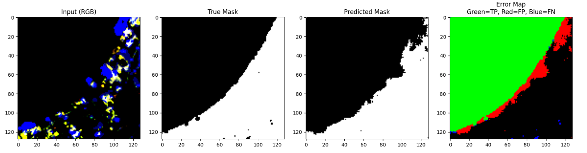

# Water Segmentation

Semantic segmentation of water bodies in multi-channel satellite imagery,
with an enhanced U-Net training workflow and a ResNet34 U-Net inference demo.

## Results

The example below shows the complete evaluation output for one image:



From left to right, the panels show the RGB input, the ground-truth mask, the
predicted mask, and a pixel-level error map. In the error map, green denotes a
true positive, red denotes a false positive, and blue denotes a false negative.

The images in [`demo/`](./demo/) are generated prediction outputs from the
deployment experiment, not redistributed source-dataset images. They provide a
compact visual example without republishing the training dataset.

## Repository contents

- [`notebooks/Water_Segmentation_Enhanced.ipynb`](./notebooks/Water_Segmentation_Enhanced.ipynb) -
  training, evaluation, and visualization
- [`deploy/`](./deploy/) - Flask inference application
- [`models/`](./models/) - trained checkpoints and normalization statistics
- [`demo/`](./demo/) - generated prediction-output examples

## Dataset

The original satellite dataset was provided privately during the internship
and is intentionally not included in this public repository. There is no
public download link documented here. If you are authorized to reproduce the
experiments, obtain the data from the internship instructor or the original
private course materials and place it at:

```text
data/data/images/
data/data/labels/
```

The notebook uses the `data/data` layout and creates experiment outputs under
`experiments_enhanced/` when training.

## Getting started

### Run the notebook

```bash
pip install torch torchvision rasterio albumentations scikit-learn matplotlib tqdm
jupyter notebook notebooks/Water_Segmentation_Enhanced.ipynb
```

### Run the Flask demo

The deployment uses the saved ResNet34 U-Net checkpoint in
[`models/smp_unet_res34_best.pth`](./models/smp_unet_res34_best.pth).

```bash
pip install -r deploy/requirements.txt
python deploy/app.py
```

Upload folders and generated result images are ignored by Git and are created
at runtime under `deploy/static/`.
